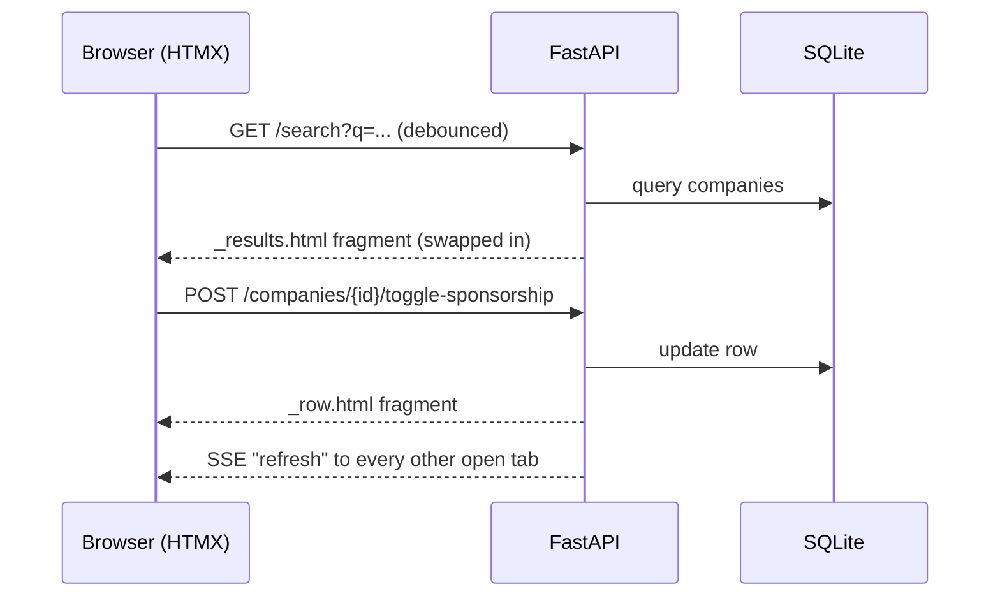

# Company Search (HTMX)

[](https://github.com/Deshraj-Jogiya/htmx-company-search/actions/workflows/ci.yml) 

A live company search with no client-side framework: FastAPI renders Jinja2 fragments, HTMX swaps them into the page, and a Server-Sent
Events channel keeps every open tab in sync.

## Highlights

- **Live search:** typing fires `hx-get="/search"` (debounced, `input changed delay:300ms`); the server re-renders the results partial.
- **Inline edit:** each row's "Sponsors H-1B" cell is a button that toggles the value in SQLite and swaps only that row.
- **Real-time sync:** `GET /events` is a `text/event-stream`; a toggle in one tab broadcasts a refresh to every other tab, without polling.
- **A bug the unit tests could not catch:** `keyup changed` never fired for autofill or paste. Driving the app in a headless browser found
  it; the trigger is now `input changed`, re-verified for typing, paste and autofill.

## Architecture



## Stack

Python, FastAPI, Jinja2, HTMX (with the SSE extension), SQLite, pytest, GitHub Actions.

## Run it

```bash
pip install -r requirements.txt
uvicorn app.main:app --reload       # open http://localhost:8000
python -m pytest tests/ -v
```
